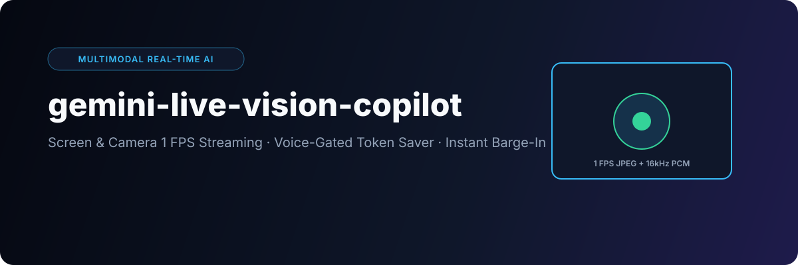
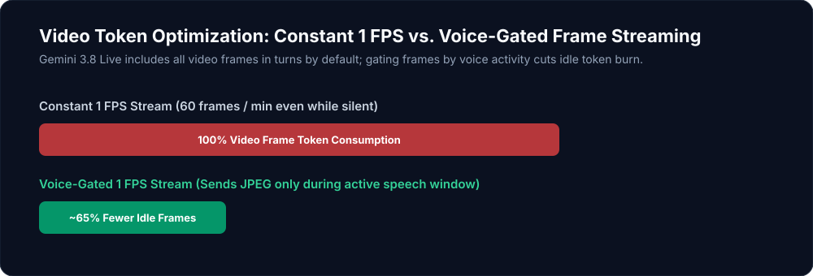
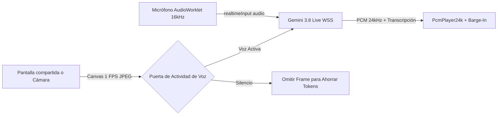

<p align="right">
  <a href="./README.md">🇺🇸 Read in English</a>
</p>

<p align="center">
  
</p>

<p align="center">
  
  
  
  
</p>

# gemini-live-vision-copilot

Copiloto **Multimodal de Voz + Visión en tiempo real** construido con **React 19**, **TypeScript** y la **Gemini Live API** (`@google/genai`). Transmite **voz PCM a 16 kHz** junto con **frames JPEG de pantalla o cámara a 1 FPS** sobre un único WebSocket con estado, incorporando **muestreo de video activado por voz (*Voice-Gated*)** para ahorrar tokens en silencios y **barge-in** instantáneo a 24 kHz.

---

## Por qué importa el muestreo activado por voz

<p align="center">
  
</p>

---

## Flujo Multimodal



---

## Inicio rápido

```bash
git clone https://github.com/stephanocamoretti-dotcom/gemini-live-vision-copilot.git
cd gemini-live-vision-copilot
npm install
cp .env.example .env
# Agrega tu VITE_GEMINI_API_KEY
npm run dev
```

---

## Ideas de escalado para producción

1. **Tokens Efímeros**: Genera tokens de corta duración en tu backend antes de abrir sesiones Live desde el navegador.
2. **`mediaResolution` adaptativa**: Reduce la resolución en monitoreo ambiental y súbela cuando el usuario pida leer texto pequeño o código en pantalla.
3. **Tool Calling asíncrono**: Combina la inspección visual con funciones `NON_BLOCKING` para crear tickets o disparar flujos CRM mientras el copiloto sigue hablando.

---

## Referencias

- [Resumen de Gemini Live API — Google AI for Developers](https://ai.google.dev/gemini-api/docs/live)
- [Guía de capacidades de Live API (Video 1 FPS, Turn Coverage, Media Resolution)](https://aistudio.google.com/docs/live-api/capabilities)
- [Inicio rápido con Gemini Live API (`@google/genai`)](https://aistudio.google.com/docs/live-api/get-started-sdk)
