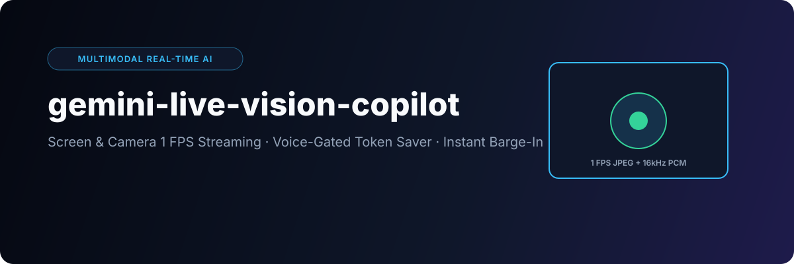
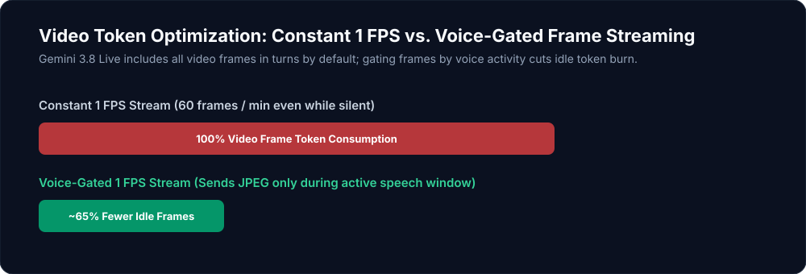
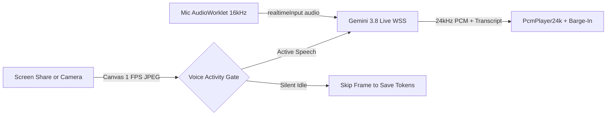

<p align="right">
  <a href="./README.es.md">🇪🇸 Leer en Español</a>
</p>

<p align="center">
  
</p>

<p align="center">
  
  
  
  
</p>

# gemini-live-vision-copilot

A real-time **Multimodal Voice + Vision Copilot** built with **React 19**, **TypeScript**, and the **Gemini Live API** (`@google/genai`). It streams **16kHz PCM voice** alongside **1 FPS JPEG screen-share or camera frames** over a single stateful WebSocket—featuring **Voice-Gated Video Sampling** to cut idle video token costs and instant 24kHz audio **barge-in**.

---

## Why Voice-Gated 1 FPS Streaming Matters

<p align="center">
  
</p>

---

## Multimodal Pipeline



---

## Quick Start

```bash
git clone https://github.com/stephanocamoretti-dotcom/gemini-live-vision-copilot.git
cd gemini-live-vision-copilot
npm install
cp .env.example .env
# Add your VITE_GEMINI_API_KEY
npm run dev
```

---

## Scaling Ideas for Production

1. **Ephemeral Tokens**: Mint short-lived Live API tokens on your backend before connecting from client browsers.
2. **Adaptive `mediaResolution`**: Dynamically lower `mediaResolution` for ambient camera monitoring and boost it when the user asks to read small UI text or code.
3. **Async UI Tool Execution**: Pair visual inspection with `NON_BLOCKING` function calling so the copilot can open tickets, annotate screenshots, or trigger workflows mid-conversation.

---

## References

- [Gemini Live API Overview — Google AI for Developers](https://ai.google.dev/gemini-api/docs/live)
- [Live API Capabilities Guide (1 FPS Video, Turn Coverage, Media Resolution)](https://aistudio.google.com/docs/live-api/capabilities)
- [Get Started with Gemini Live API (`@google/genai`)](https://aistudio.google.com/docs/live-api/get-started-sdk)
